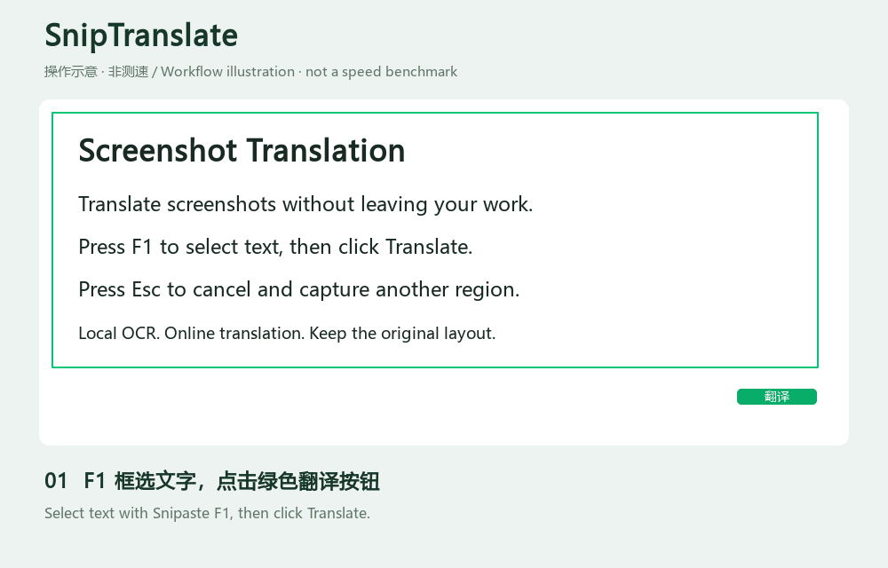

# SnipTranslate · Translation Companion for Snipaste

[简体中文](README.md) · **English**

Add a translation button to Snipaste: **F1 → select a region → click Translate → view the translated image in place**. Snipaste continues to handle F3 pinning.

This is a separate companion application, currently adapted to **Snipaste 2.11.3 x64**. The application UI is in Simplified Chinese.



*Workflow illustration. Animation timing is not a translation-speed benchmark.*

## Download and use

Download **SnipTranslate-v0.2.0-windows-x64.zip** from [Releases](https://github.com/gulzxeric/SnipTranslate/releases). Windows 10/11 x64 is required; Python is not needed for the packaged application.

1. Install and start [Snipaste](https://www.snipaste.com/) separately. It is not included in the archive.
2. **Extract the entire archive.** Keep `SnipTranslate.exe` together with the `_internal` folder.
3. Run `SnipTranslate.exe`. If Snipaste cannot be found on first launch, select your installed `Snipaste.exe` when prompted.
4. Allow the local OCR models to load, press F1 to select text, and click the green **翻译** (Translate) button below Snipaste's toolbar.
5. Switch between source and translation, copy, save, pin, or select **文字** (Text) to inspect plain text.
6. Press **Esc** or click **取消** (Cancel) while translating, then press F1 for another capture. Old results and errors cannot overwrite the new capture.

The application runs in the system tray. Right-click its icon for settings, the latest result, **检查更新** (Check for updates), or Exit. Update checks show version information and a link to GitHub Releases; downloading and replacing the application remains your choice. The translation button disappears when the capture completes or is cancelled.

### Start with Windows

Press Win+R, enter `shell:startup`, and put a **shortcut** to `SnipTranslate.exe` in that folder. Enable startup for Snipaste as well. Keep the application folder at the same location afterward.

## Features and data handling

- **Local OCR:** RapidOCR and ONNX Runtime are the default, with bundled Chinese/English models. Screenshot pixels are not uploaded to the translation service. Windows system OCR is also available.
- **Online Google translation:** Only recognized text is sent to Google. The default public endpoint does not require a key; it is not an officially supported Cloud API and may change or rate-limit requests.
- **Official Cloud API:** Select Google Cloud Translation to use your own enabled service, billing account, and API key. Keys are protected with Windows DPAPI. The `GOOGLE_TRANSLATE_API_KEY` environment variable is also supported.
- **Proxy:** If Google is unreachable, configure a working HTTP / HTTPS proxy, such as `http://127.0.0.1:7890`.
- **Image layout:** Translated paragraphs are drawn in place using estimated background, foreground, and font size. Flat webpage and document backgrounds work best.

Settings and logs are stored in `%LOCALAPPDATA%\SnipTranslate`. Normal operation does not automatically save screenshots to disk.

## Performance and limitations

OCR is warmed up in the background. Successive captures reuse HTTPS connections, paragraph requests are batched, and image preparation and rendering reduce processing overhead.

The displayed completion time starts **when you click Translate**, including capture retrieval, preparation, recognition, network requests, and rendering. Hover over it for stage timings. Logs include timings and image dimensions. An OCR-only benchmark on a small image is not the total translation time; image size, text volume, initial loading, and network conditions all affect latency.

Currently verified only on the development machine with Snipaste 2.11.3 x64. Other versions, toolbar layouts, or differing process permissions require testing. Complex backgrounds, unusual fonts, rotated text, and long translations may produce imperfect layouts. Results are centered when positioning information is unavailable from the current capture log. Windows OCR requires the relevant system language components and should be tested on the destination machine.

## Development and packaging

Windows x64 and Python 3.11 or newer are required; the current development environment uses Python 3.13.

```powershell
py -3 -m venv .venv
.venv\Scripts\python.exe -m pip install -r requirements.txt
.venv\Scripts\python.exe run.py
```

You can also use `Start.cmd`. Run tests, build, and create a release archive with:

```powershell
.venv\Scripts\python.exe -m pip install pytest pyinstaller
.venv\Scripts\python.exe -m pytest -q
.\build.ps1
.venv\Scripts\python.exe tools\package_release.py
```

The build downloads the default OCR models. Archives, SHA-256 checksums, and third-party notices are written to `dist\releases`. Distribute the complete application directory.

Benchmark: `tools\benchmark_translation.py IMAGE_PATH`. For read-only diagnostics while a Snipaste selection is open:

```powershell
.venv\Scripts\python.exe -m screen_translate.snipaste_native --diagnose --accessibility
```

## Feedback and third-party components

The project source is licensed under the [MIT License](LICENSE), copyright **eric**. Third-party components retain their respective licenses.

Open an [issue](https://github.com/gulzxeric/SnipTranslate/issues) with your Windows / Snipaste version, image dimensions, timings, and error details. Remove sensitive content before sharing screenshots.

The archive includes third-party license files, versions, and source references. SnipTranslate is an independent project, unaffiliated with Snipaste or Google.

[Snipaste command-line documentation](https://docs.snipaste.com/command-line-options) · [RapidOCR](https://github.com/RapidAI/RapidOCR) · [Google Cloud Translation](https://cloud.google.com/translate/docs/basic/translating-text) · [Windows OCR](https://learn.microsoft.com/en-us/uwp/api/windows.media.ocr)
